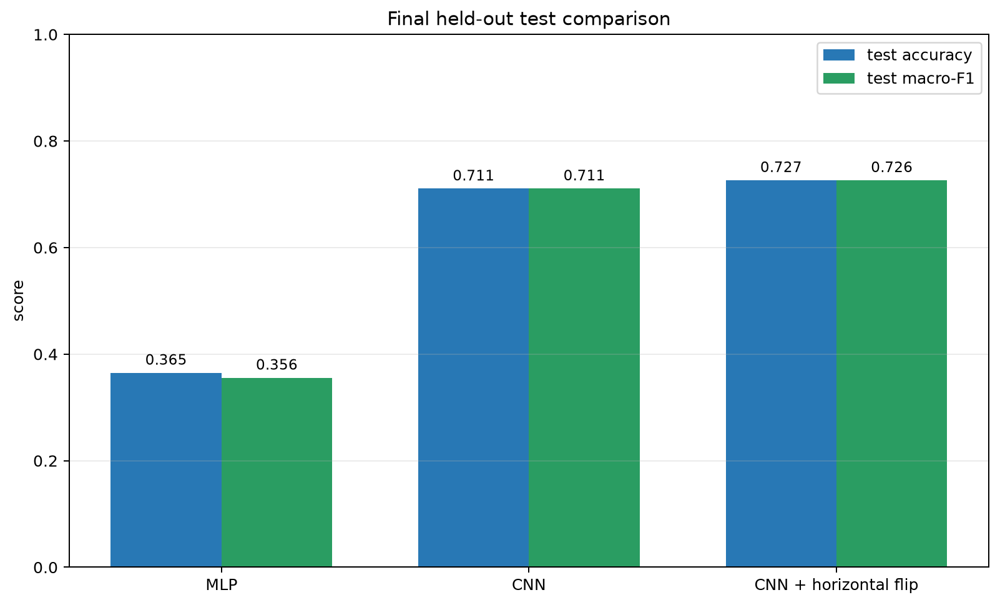

# Imagenette Classification

第二次学习规划的 Imagenette 图像分类实验项目。

## 项目目标

在相同的数据划分和共同训练条件下完成三组实验：MLP 基线、CNN 基线和 CNN 水平翻转对照；按内部验证集选择模型，再在官方留出测试集上完成一次最终评价。

## 当前进度

- [x] 建立项目目录
- [x] 记录运行环境
- [x] 下载并检查 Imagenette 数据
- [x] 初始化本地 Git 仓库并推送至 GitHub
- [x] 固定数据划分与类别映射
- [x] 生成 10 类样本图与各划分的类别数量统计
- [x] 实现共享的数据读取与预处理，并检查真实 batch
- [x] 定义 MLP 与 CNN，并检查结构、参数量和层输出形状
- [x] 建立三组实验配置与训练循环，并完成单 batch 冒烟测试
- [x] 完成三组训练，并按内部验证集选择最佳权重
- [x] 完成三组最终留出测试、混淆矩阵和错误样例分析
- [x] 整理曲线、对比图表、实验报告和学习过程记录

## 最终结果

三组实验使用相同的数据划分与共同训练设置。模型只根据内部验证集选择最佳 epoch；官方 `val/` 的 3,925 张图片仅用于最后一次独立测试。

| 实验 | 最佳 epoch | 测试 Accuracy | 测试 Macro-F1 |
| --- | ---: | ---: | ---: |
| MLP | 15 | 0.3651 | 0.3558 |
| CNN | 18 | 0.7108 | 0.7110 |
| CNN + horizontal flip | 20 | **0.7266** | **0.7265** |

在本次固定 seed=42 的对照中，CNN 明显优于直接展平图片的 MLP；仅在训练集加入随机水平翻转的 CNN-Flip 获得最佳测试 Accuracy（72.66%）。完整的实验设计、曲线解读与错误分析见：[实验报告](report/experiment_report.md)。



## 目录说明

| 目录 | 用途 |
| --- | --- |
| `src/` | 数据、模型、训练、评价和绘图代码 |
| `configs/` | 实验配置、类别映射和固定数据划分 |
| `data/` | Imagenette 原始数据（不提交到 Git） |
| `outputs/` | 训练记录、指标、曲线、混淆矩阵和预测案例 |
| `checkpoints/` | 按最佳验证集准确率保存的模型权重（不提交到 Git） |
| `report/` | 实验报告与结论说明 |

## 环境

2026-11-19 检测结果：

- 项目解释器：Python 3.13.7（`.venv`）
- PyTorch：2.7.1+cu118
- TorchVision：0.22.1+cu118
- 训练设备：NVIDIA GeForce RTX 3070 Ti Laptop GPU（CUDA 可用）

每次开始项目工作前，在 PowerShell 中执行：

```powershell
cd C:\Users\Gezihao\Desktop\学习记录\imagenette-classification
.\.venv\Scripts\Activate.ps1
```

## 数据位置

数据已下载并解压至：`data/imagenette2-160/`。

- 官方 `train/`：9,469 张 JPG 图片，已按类别分层划分为训练集和内部验证集。
- 官方 `val/`：3,925 张 JPG 图片，只用于最终留出测试。
- `noisy_imagenette.csv`：本项目不使用。

## 固定数据划分

运行下面的命令可重新生成固定划分与数据检查结果：

```powershell
python src\prepare_data.py
```

脚本使用 `seed=42`，不会移动或复制原始图片，只在 CSV 中记录每张图片的归属：

- `configs/class_mapping.json`：类别文件夹名、数字标签和可读类别名的对应关系。
- `configs/train.csv`：7,575 张训练图片。
- `configs/val.csv`：从官方 `train/` 分层划出的 1,894 张内部验证图片。
- `configs/test.csv`：官方 `val/` 的 3,925 张最终留出测试图片。
- `outputs/data/sample-grid.png`：覆盖 10 类、带标签的真实训练样本图。
- `outputs/data/class_counts.csv`：三个划分中各类别的图片数量。

后续 MLP、CNN 和 CNN 水平翻转对照必须复用这些 CSV，不重新随机划分数据。

## 数据读取与预处理

三个实验都通过 `src/data.py` 读取固定划分，并统一执行：RGB 转换、短边缩放至 160、中心裁剪为 `160×160`、`ToTensor()` 像素缩放到 `0~1`。

只有 `cnn-flip` 实验的**训练集**额外在中心裁剪之后、转张量之前执行 `RandomHorizontalFlip(p=0.5)`；验证集和测试集不翻转。

训练前可运行以下命令检查真实 batch：

```powershell
python src\inspect_batch.py
python src\inspect_batch.py --horizontal-flip
python src\inspect_batch.py --split val
```

检查结果应包含：训练集 7,575 张、验证集 1,894 张；图像批次形状为 `(64, 3, 160, 160)`，数据类型为 `float32`，像素范围为 `0~1`。

## 模型结构检查

模型定义位于 `src/models.py`，可使用真实训练 batch 检查模型：

```powershell
python src\inspect_models.py
```

- MLP：`Flatten(76800) → Linear(76800, 256) → ReLU → Linear(256, 10)`，可训练参数总量为 19,663,626。
- CNN：四组 `3×3 Conv → ReLU → 2×2 MaxPool`（输出通道为 32、64、128、128），接 `AdaptiveAvgPool2d(4×4)`、`Linear(2048, 256)`、ReLU 和 `Linear(256, 10)`；可训练参数总量为 767,946。
- 两种模型都输出形状 `(64, 10)` 的原始类别得分（logits）。训练时交叉熵损失直接接收 logits，不在模型末尾加入 softmax。

## 训练配置与运行

三组实验配置分别位于 `configs/mlp.yaml`、`configs/cnn.yaml` 和 `configs/cnn-flip.yaml`。三组共同使用：seed=42、交叉熵损失、Adam、学习率 0.001、batch size 64、weight decay 0、20 个 epoch、无预训练权重。

`cnn` 与 `cnn-flip` 的模型结构、数据划分、初始随机种子、优化器和训练参数相同；唯一差异是 `cnn-flip` 的训练预处理中开启 `horizontal_flip_train: true`。

训练前可做无输出文件的单 batch 冒烟测试：

```powershell
python src\train.py --config configs\mlp.yaml --smoke-test
python src\train.py --config configs\cnn.yaml --smoke-test
python src\train.py --config configs\cnn-flip.yaml --smoke-test
```

正式训练命令如下。每次正式运行都会重新创建模型和优化器，完整训练 20 个 epoch：

```powershell
python src\train.py --config configs\mlp.yaml
python src\train.py --config configs\cnn.yaml
python src\train.py --config configs\cnn-flip.yaml
```

每个 epoch 会保存训练/验证 loss 与 accuracy 至 `outputs/<实验名>/history.csv`。只有验证 accuracy 严格更高时才保存 `checkpoints/<实验名>/best.pt`；若并列，保留较早轮次。训练过程不读取最终测试集。

## 最终测试与结果绘图

训练结束后，重新加载每组由内部验证集选出的 `best.pt`，在 3,925 张最终测试图上生成 Accuracy、Macro-F1、逐类召回率、预测 CSV、混淆矩阵和多类别样例图：

```powershell
python src\evaluate.py --config configs\mlp.yaml
python src\evaluate.py --config configs\cnn.yaml
python src\evaluate.py --config configs\cnn-flip.yaml
```

下列命令只读取已保存的训练历史和测试指标，生成训练/验证曲线、测试指标柱状图与总对比表，不会重新训练模型：

```powershell
python src\plot_results.py
```

- 训练/验证曲线：`outputs/summary/training-curves.png`
- 最终测试对比图：`outputs/summary/test-comparison.png`
- 最终结果表：`outputs/summary/comparison.csv`
- 完整分析报告：[report/experiment_report.md](report/experiment_report.md)

## 版本控制

- 本地默认分支：`main`
- GitHub 私有仓库：[smallmoon661/imagenette-classification](https://github.com/smallmoon661/imagenette-classification)
- 原始数据、虚拟环境和模型权重通过 `.gitignore` 排除，不进入普通 Git 提交。
