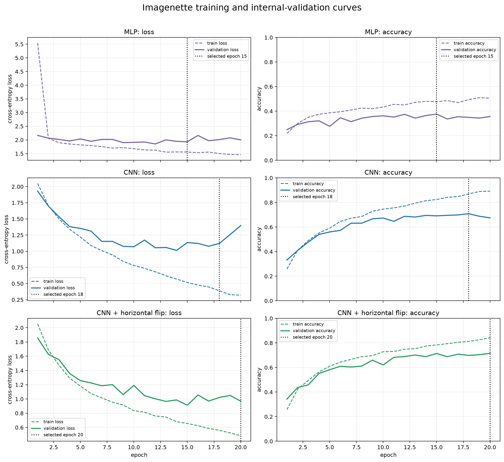
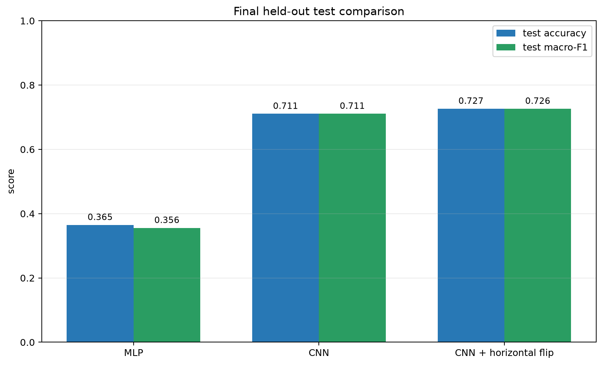
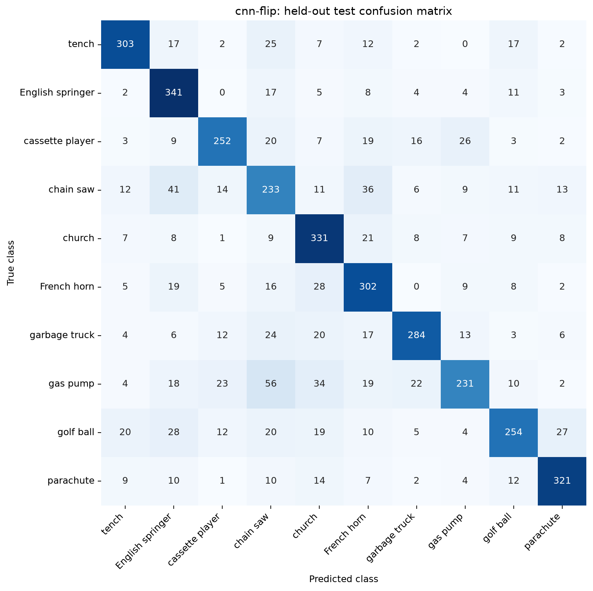
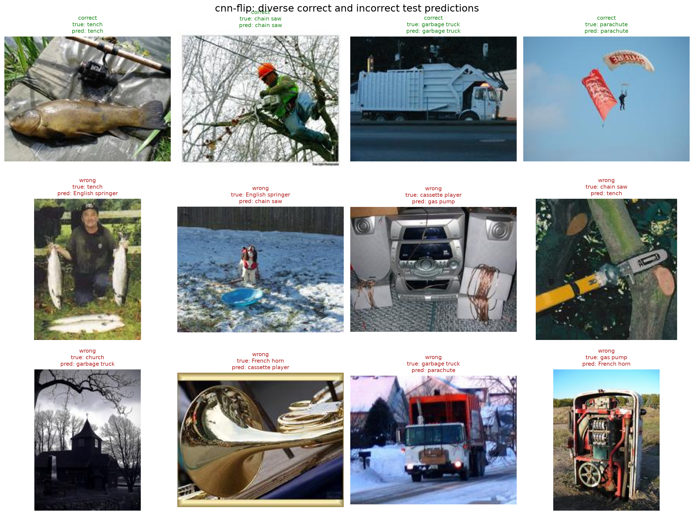

# Imagenette 图像分类实验报告

## 1. 实验目标

本实验使用 Imagenette-160 的 10 个类别，比较三种图像分类方案：

1. MLP 基线：直接将图片展平后分类；
2. CNN 基线：使用卷积提取图片局部空间特征；
3. CNN + horizontal flip：与 CNN 基线保持相同模型和训练设置，只在训练阶段加入随机水平翻转。

实验的核心问题是：卷积结构是否比 MLP 更适合该图像分类任务，以及随机水平翻转是否能提升 CNN 的泛化表现。

## 2. 实验环境与可复现设置

- 操作系统：Windows 11
- Python：3.13.7（项目专用 `.venv`）
- PyTorch：2.7.1+cu118
- TorchVision：0.22.1+cu118
- GPU：NVIDIA GeForce RTX 3070 Ti Laptop GPU
- 随机种子：42
- 优化器：Adam
- 学习率：0.001
- Weight decay：0
- Batch size：64
- 训练轮数：20
- 损失函数：交叉熵损失（`CrossEntropyLoss`）

训练前固定 Python、NumPy 与 PyTorch 的随机数种子；CNN 与 CNN-Flip 使用相同的初始权重哈希值，因此两组实验的主要设计差异只有训练图片是否进行随机水平翻转。

## 3. 数据集与数据划分

数据集为 Imagenette-160，共包含 10 个类别：`tench`、`English springer`、`cassette player`、`chain saw`、`church`、`French horn`、`garbage truck`、`gas pump`、`golf ball`、`parachute`。

- 官方 `train/`：9,469 张 JPG 图片；
- 以 seed=42 按类别分层切分官方训练集：7,575 张训练图、1,894 张内部验证图；
- 官方 `val/`：3,925 张图片，完整保留为最终测试集。

所有实验复用同一份划分 CSV。内部验证集只用于选择最佳 epoch；最终测试集不参与训练、选模型或调参。

### 预处理与增强

所有图片均转换为 RGB，短边缩放至 160，再进行 `CenterCrop(160)`，最后使用 `ToTensor()` 将像素转换到 0~1。

- MLP、CNN：训练、验证、测试均使用统一的基础预处理；
- CNN-Flip：仅训练集在中心裁剪后、转张量前，以 0.5 概率执行水平翻转；验证集和测试集不翻转。

## 4. 模型设计

| 模型 | 结构概要 | 可训练参数 |
| --- | --- | ---: |
| MLP | `Flatten(76800) → Linear(76800,256) → ReLU → Linear(256,10)` | 19,663,626 |
| CNN | 4 组 `3×3 Conv → ReLU → 2×2 MaxPool`，通道为 32/64/128/128；随后 `AdaptiveAvgPool(4×4) → Flatten → Linear(2048,256) → ReLU → Linear(256,10)` | 767,946 |
| CNN-Flip | 与 CNN 完全相同；仅训练数据增加水平翻转 | 767,946 |

虽然 MLP 的参数量更多，但它会把 `(3,160,160)` 图片展平，无法直接利用相邻像素构成的空间结构。CNN 的局部连接与权重共享更适合视觉任务。

## 5. 训练与模型选择

每个训练 batch 按以下顺序运行：

1. 前向传播得到 10 个类别的 logits；
2. 交叉熵损失衡量 logits 与真实标签的差异；
3. `loss.backward()` 计算各参数梯度；
4. Adam 的 `optimizer.step()` 更新参数。

每轮都记录训练集与内部验证集的 loss、accuracy。只有内部验证 accuracy 严格提高时才保存 `best.pt`；若出现并列，保留较早的 epoch。训练结束后，在新进程中重载该最佳权重，统一在 3,925 张最终测试图上评价一次。



从曲线可见，MLP 在第 15 轮后训练指标继续改善但验证指标没有持续提高。普通 CNN 在第 18 轮后也出现训练继续改善、验证回落的趋势，因此保存第 18 轮而不是最后一轮。CNN-Flip 的训练准确率低于普通 CNN，但内部验证表现更高，符合数据增强增加训练样本变化、缓解单纯记忆训练图片的预期。

## 6. 最终测试结果

| 实验 | 最佳 epoch | 最佳内部验证 Accuracy | 测试 Accuracy | 测试 Macro-F1 |
| --- | ---: | ---: | ---: | ---: |
| MLP | 15 | 0.3765 | 0.3651 | 0.3558 |
| CNN | 18 | 0.7086 | 0.7108 | 0.7110 |
| CNN + horizontal flip | 20 | 0.7154 | **0.7266** | **0.7265** |



结果表明：

- CNN 测试 Accuracy 为 0.7108，比 MLP 高 0.3457（34.57 个百分点）；卷积结构显著优于直接展平图片的 MLP。
- CNN-Flip 达到最高测试 Accuracy 0.7266，相比普通 CNN 提高 0.0158（1.58 个百分点）。
- 每组实验的 Accuracy 与 Macro-F1 非常接近，说明结果并非完全由少数类别主导。
- 上述结论针对当前数据划分、随机种子和 20 epoch 设置成立；如需更稳健地推广，应使用多个随机种子重复实验并报告均值与波动。

## 7. CNN-Flip 错误分析



混淆矩阵中，行表示真实类别，列表示预测类别；对角线是正确分类数量，非对角线描述具体错误方向。

- `English springer`、`parachute`、`church` 的识别相对较好；
- `gas pump` 的召回率为 0.5513，是较难的类别；其中有 56 张真实 `gas pump` 被预测为 `chain saw`；
- 真实 `chain saw` 也会被预测成 `English springer` 或 `French horn`，表明模型可能会被背景、物体尺度或局部纹理影响。



样例图中的正确案例通常主体清晰、尺寸较大；错误案例常出现主体较小、背景复杂、遮挡、光照或视角变化等情况。样例图采用确定性的按类别选取方式：4 张正确样例来自 4 个不同类别，8 张错误样例来自 8 个不同类别。因此它适合辅助理解错误原因，但不能替代混淆矩阵和整体统计指标。

## 8. 结论

在本实验的固定数据划分和训练设置下：

1. CNN 明显优于 MLP，说明利用空间结构对图像分类十分重要；
2. 仅加入训练阶段随机水平翻转，就使 CNN 的最终测试 Accuracy 从 71.08% 提升到 72.66%；
3. 最佳方案是 **CNN + horizontal flip**；
4. 最终测试集只用于一次独立评估，不能再根据该结果调整模型或超参数；后续若继续改进，应重新定义实验方案，使用内部验证集做选择，并保留独立测试集做最终比较。

## 9. 结果文件与复现命令

- 训练记录：`outputs/<experiment>/history.csv`
- 最终指标：`outputs/<experiment>/metrics.json`
- 单图预测：`outputs/<experiment>/predictions.csv`
- 最佳权重：`checkpoints/<experiment>/best.pt`（不提交到 Git）
- 汇总图表：`outputs/summary/`

在激活项目 `.venv` 后，可使用以下命令：

```powershell
# 三组训练（已经完成，不必重复执行）
python src/train.py --config configs/mlp.yaml
python src/train.py --config configs/cnn.yaml
python src/train.py --config configs/cnn-flip.yaml

# 重新生成最终测试产物（不重新训练）
python src/evaluate.py --config configs/mlp.yaml
python src/evaluate.py --config configs/cnn.yaml
python src/evaluate.py --config configs/cnn-flip.yaml

# 重新生成对比表和曲线（不重新训练）
python src/plot_results.py
```
